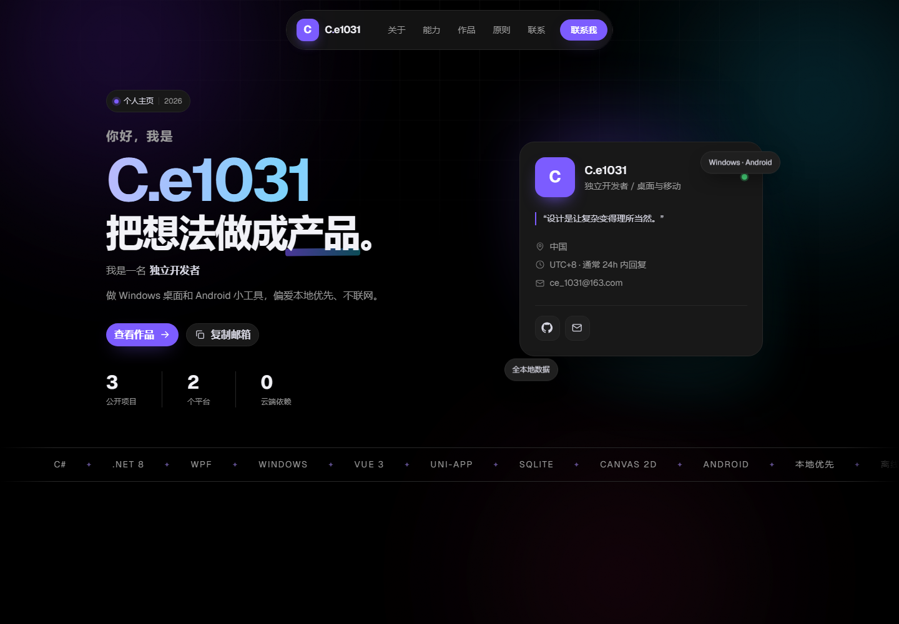
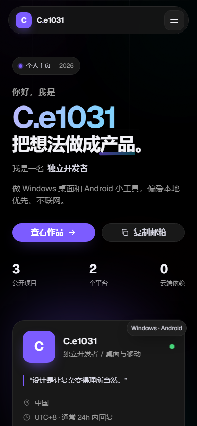

# C.e1031 · 个人主页

线上地址：**<https://dzy1145.github.io/>**

一个只用来**展示自己**的个人主页：介绍、作品、原则、联系方式。不是求职页，也不是接项目的落地页，所以没有 CTA 漏斗、没有报价 FAQ、没有客户评价区。

纯 **HTML + CSS + 原生 JavaScript**，无框架、无构建、无第三方请求。设计系统按 `landing-page-design` 的视觉规范落地：自托管 Geist、8pt 间距、Tailwind 字号阶梯、扁平表面、悬浮胶囊导航、全高移动菜单。

- 手机 / 平板 / 桌面三档布局
- 支持 `prefers-reduced-motion`，动效尊重系统设置
- 含 SEO、Open Graph、JSON-LD、favicon、1200×630 分享图和 404 页
- 无统计、无 Cookie，字体也不走外部 CDN





## 本地预览

直接双击 `index.html` 就能看（Geist 字体在 `file://` 下也能正常加载）。

更推荐起一个本地服务器（剪贴板 API 的行为更接近线上）：

```bash
cd wdq0921
python -m http.server 8080
```

然后打开 <http://localhost:8080>。不需要 Node，也不需要 `npm install`。

## 文件结构

```text
wdq0921/
├── index.html                # 页面结构与全部文案
├── styles.css                # 设计系统（字体、颜色、间距、动效、响应式）
├── script.js                 # 导航、打字机、滚动显现、复制邮箱、聚光/倾斜
├── 404.html                  # 自定义 404
├── assets/
│   ├── favicon.svg
│   ├── og.png                # 社交分享图（1200×630）
│   ├── fonts/                # Geist / Geist Mono + OFL 授权
│   └── projects/
│       ├── deskpanel-settings.png
│       ├── zaoba.png
│       └── jianji.png
├── preview/
│   ├── home-desktop.png      # README 预览图
│   ├── home-mobile.png
│   └── og-template.html      # 分享图模板，改完文字后截图覆盖 og.png
└── README.md
```

## GitHub 项目

账号：[dzy1145](https://github.com/dzy1145)。页面上三个作品都来自这里：

| 项目 | 简介 | 技术 | 链接 |
| --- | --- | --- | --- |
| **DeskPanel** | Windows 桌面右侧常驻侧栏：硬件监控、常用软件、服务开关、开机启动项（含 Store 应用），带可视化设置 | C# / WPF / .NET 8 / Windows API | [源码](https://github.com/dzy1145/DeskPanel) · [下载 v1.4.0](https://github.com/dzy1145/DeskPanel/releases) |
| **早八** | 纯本地安卓课表：周课表按周次过滤、多学期、节次表、深浅色主题；教务 .xls / JSON 导入、269 校教务抓取、启动自动检查更新 | Vue 3 / uni-app / SQLite | [源码](https://github.com/dzy1145/zaoba) · [下载 v1.2.1](https://github.com/dzy1145/zaoba/releases) |
| **简记** | 本地记账 Android App：按天列账、月度统计、趋势折线、分类占比；账目不上云 | Vue 3 / uni-app / Canvas 2D | [源码](https://github.com/dzy1145/jianji) · [下载 v1.4.9](https://github.com/dzy1145/jianji/releases) |

首屏统计也是从这三个项目推出来的：**3** 个公开项目、**2** 个平台（Windows / Android）、**0** 个云端依赖。

## 设计系统

### 字体

- 拉丁字母与数字：**Geist**（可变字重 100–900），自托管 `assets/fonts/Geist-Variable.woff2`
- 代码与数字：**Geist Mono**
- 中文：回落到 PingFang SC / 鸿蒙 / 微软雅黑，不额外下载中文字体

字体授权见 `assets/fonts/OFL.txt` 与 `LICENSE.txt`。要换字体，改 `styles.css` 顶部的 `--font-sans` / `--font-mono`。

### 字号

只使用 Tailwind 的阶梯：12 / 14 / 16 / 18 / 20 / 24 / 30 / 36 / 48 / 60 / 72 / 96 px。桌面端首屏名字 96、陈述 60；区块标题 36；正文 16；次要信息 12–14。

### 间距与圆角

间距只用 0 / 2 / 4 / 8 / 12 / 16 / 24 / 32 / 40 / 48 / 64 / 80 / 96；圆角使用 12 / 16 / 24 / 999。区块上下留白 96（移动端 64），卡片内边距 24 / 32，按钮 8×12。

### 颜色

深色表面取规范里的黑灰阶：`#000` 背景、`#181818` 卡片、`#1F1F1F` 次级表面、`#272727` 描边。品牌紫 `#7C5CFF` 与青色 `#22D3EE` 只做强调；背景光晕是独立装饰层，不写进卡片背景。

### 动效

- 统一曲线 `cubic-bezier(0.22, 1, 0.36, 1)`
- 进场位移 32px、700ms，只播一次
- 技能条用 `scaleX` 而不是 `width`
- 移动菜单全屏打开，链接按 60ms 递增入场
- 所有按钮有 hover / active / focus 状态

## 内容状态

姓名、邮箱、GitHub、三个作品、技能、统计和原则都已经是真实内容：

| 项目 | 当前值 |
| --- | --- |
| 姓名 | `C.e1031` |
| 邮箱 | `ce_1031@163.com`（全站 10 处，含 `mailto:`） |
| GitHub | `https://github.com/dzy1145`（全站 10 处，含 6 个仓库 / Release 链接） |
| 作品 | DeskPanel、早八、简记 |
| 统计 | 3 / 2 / 0 |

站点已部署到 **<https://dzy1145.github.io/>**：`og:image`、`twitter:image`、`og:url`、`canonical` 和 JSON-LD 都已指向这个域名。

分享图已按当前姓名和邮箱生成。以后要改，打开 `preview/og-template.html`，替换文字后按 1200×630 截图，覆盖 `assets/og.png` 即可；favicon 改 `assets/favicon.svg` 里的字母路径。

## 自定义

### 修改技能条

```html
<li class="meter" style="--v:.90;--d:.15s">
  <div class="meter__label"><span>C# / .NET 8</span><span>90</span></div>
  <div class="meter__track"><span class="meter__fill"></span></div>
</li>
```

`--v` 是 0–1 的小数（进度条用 `scaleX`），`--d` 是动画延迟，右侧数字只是展示值。

### 增加 / 删除作品

- `project project--featured`：整行大卡，左封面右文字
- `project`：两列普通卡
- `project project--wide`：整行横卡（当前未使用）

封面有三种现成写法：

- 大截图：`<div class="project__cover cover--deskpanel"></div>`
- App 图标：`<div class="project__cover cover--zaoba"></div>`
- 纯 CSS 大字母：`.cover__letter`

复制一个 `<article class="project">` 改内容即可；技术标签用 `.tags` 里的 `<li>`。

### 删除区块

同时删掉 `<section id="...">` 和导航里对应的链接。脚本对区块数量没有硬编码。

### 关闭动效

系统开启「减少动态效果」后，滚动显现、打字机、跑马灯、数字滚动都会自动停用；进度条直接显示最终值。

## 部署（不需要云服务器）

纯静态站点，以下任一方式都够用：

### GitHub Pages

1. 新建仓库，把 `index.html`、`404.html`、`styles.css`、`script.js`、`assets/` 推上去
2. Settings → Pages → Source 选 **Deploy from a branch**
3. 分支 `main`，目录 `/ (root)`，保存
4. 一分钟后访问 `https://<用户名>.github.io/<仓库名>/`

> 用户主页仓库必须命名为 `<用户名>.github.io`；`404.html` 会自动生效。

### Cloudflare Pages（国内访问通常更稳）

连接 Git 仓库，构建命令留空，输出目录填 `/`；或用 **Direct Upload** 直接拖文件夹。

### Vercel / Netlify

Framework Preset 选 **Other**，Build Command 留空，Output Directory 填 `.`。

### 国内对象存储

阿里云 OSS / 腾讯云 COS 开启「静态网站托管」，上传 `index.html`、`404.html`、`styles.css`、`script.js` 和 `assets/`，绑定自定义域名并挂 CDN。大陆节点需要域名完成 ICP 备案。

### 什么时候才需要服务器？

登录、数据库、后台管理、服务端渲染、微信生态对接才需要。纯展示页不必买服务器。

## 已实现

- 悬浮胶囊导航、当前区块高亮、滚动后描边与阴影
- 移动端全屏菜单：链接逐条入场，Esc / 点关闭按钮收起，打开时锁定滚动
- 滚动渐显、数字滚动、角色打字机
- 名片聚光与轻微 3D 倾斜（仅精确指针设备）
- 复制邮箱（Clipboard API + `execCommand` 兜底）与 Toast
- 回到顶部
- 键盘可访问：skip link、focus ring、语义化标题层级
- 打印样式：可另存为 PDF 简版简历
- 404 页、OG / Twitter / JSON-LD、favicon
- 无第三方请求；字体、样式、脚本、项目截图全部本地

## 浏览器支持

最近两年的 Chrome / Edge / Firefox / Safari。`backdrop-filter`、`mask-image` 在旧浏览器上会优雅降级，不影响阅读；不支持 IE。

## 可以继续扩展

- 博客 / 文章页（迁移到 Astro 或 Next.js）
- 每个作品一个详情页
- 访问统计（Umami / Plausible）——目前页脚写明「无统计、无 Cookie」，加了统计记得同步改页脚

## 说明

`preview/` 里只上传了 README 预览图和分享图模板；目录里另有 `pelican-*` 图片属于别的项目，与本页面无关，未上传。线上地址：<https://dzy1145.github.io/>。
